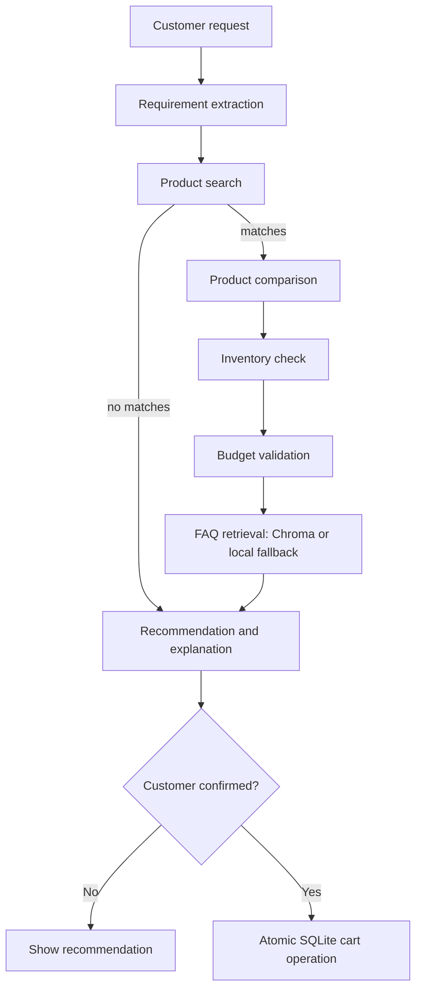

# Agentic AI-Based E-Commerce Product Recommendation and Shopping Assistant

A local-first laptop shopping assistant built with Streamlit, LangGraph, LangChain, Pandas, SQLite, and optional OpenAI-powered FAQ retrieval with ChromaDB. Catalog search, comparison, budget checks, inventory checks, recommendations, and simulated cart operations work without an API key. OpenAI is used for natural-language requirement extraction and FAQ answers when configured; deterministic fallbacks keep the demo usable offline.

All product listings and prices are illustrative sample data, not live offers. Cart creation is simulated and does not place an order.

## Project Overview

The assistant accepts a natural-language request, extracts shopping preferences, searches a local CSV catalog, compares candidates, verifies SQLite inventory and budget, retrieves product FAQs, ranks suitable products, and waits for explicit confirmation before adding a product to a SQLite cart.

## Architecture



`graph.py` compiles these steps as a LangGraph `StateGraph`. The cart node is reachable only when the invocation explicitly confirms a selected product. Inventory is rechecked transactionally when the cart is created.

## Project Structure

```text
app.py
graph.py
state.py
database.py
models.py
requirements.txt
.env.example
agents/
tools/
data/products.csv
data/faqs/faq_laptop.txt
tests/
```

## Installation

Python 3.11 or newer is required.

```bash
python -m venv .venv
source .venv/bin/activate       # Windows: .venv\Scripts\activate
python -m pip install -r requirements.txt
cp .env.example .env            # Optional: add an OpenAI API key for LLM/RAG features
```

Without `OPENAI_API_KEY`, the app uses deterministic preference extraction and keyword-based FAQ retrieval. With a key, it uses `ChatOpenAI`, OpenAI embeddings, ChromaDB, and LangChain `RetrievalQA`. Chroma's first run downloads the selected embedding model through the OpenAI API.

## Running Streamlit

From the project directory:

```bash
streamlit run app.py
```

The UI accepts a requirement, budget, and RAM preference; it displays matching products, comparison, inventory, FAQs, and recommendation. Use the explicit **Add to cart** action to simulate adding the selected in-stock product. The local SQLite database is created at `data/shopping_assistant.db` on first use.

## Sample Screenshots

The app renders a responsive Streamlit workspace with a requirement form, ranked product results, comparison and availability details, FAQ answers, and a confirmation-gated cart summary. Screenshots can be captured from the running app using Streamlit's browser view; no production listing or order is shown because all data is simulated.

## Testing

```bash
pytest -q
```

Tests cover product search, comparison, inventory, budget validation, and cart confirmation/persistence. Tests use a temporary SQLite database and do not need an OpenAI key.

## Future Enhancements

- Connect to a live catalog, delivery estimates, and authenticated customer profiles.
- Add product review sentiment and recurring-complaint analysis.
- Add order lifecycle, cart expiration, and concurrency/load tests.
- Evaluate recommendation quality against a curated set of shopping requests.